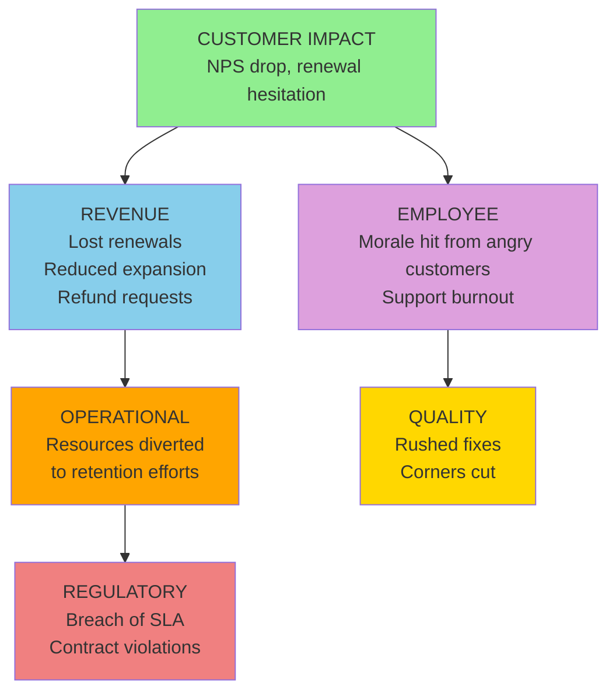

# D1: Customer Impact

> **Core Question:** How does this problem affect the people who pay us?

Customer impact is often the **most visible** dimension, and one of the most dangerous when it cascades.

**Most common next layer:** Customer → Revenue (in 29 of the 50 published cases where Customer is the origin)

## Observable Signals

Don't wait for customers to leave. Look for **early warning signals** in your systems:

| Signal Type | Observable | Data Source | Detection Speed |
|-------------|------------|-------------|-----------------|
| **Immediate** | Support ticket spike | Helpdesk (Zendesk, ServiceNow) | Hours |
| **Behavioral** | Renewal hesitation | Sales notes, CRM | Days-Weeks |
| **Sentiment** | NPS/CSAT score drop | Survey platforms | Weekly |
| **Engagement** | Product usage decline | Analytics (Mixpanel, Amplitude) | Days |
| **Escalation** | Exec-level complaints | Email, meeting requests | Hours |
| **Silent** | Reduced feature adoption | Product analytics | Weeks |
| **Churn** | Cancellation requests | Billing/CRM | Immediate |
| **Trust** | Reference refusals | Sales team feedback | Variable |

## Trigger Keywords

Language patterns indicate severity. Train your team to flag these:

### High Urgency (Sound = 8-10)

```
"unacceptable"             "breach of contract"      "legal action"
"canceling"                "considering alternatives" "escalating"
"demand refund"            "not what we signed up for"
```

**Action:** Executive escalation within 1 hour.

### Medium Urgency (Sound = 4-7)

```
"disappointed"             "concerned about"         "need clarification"
"frustrating"              "expected better"         "reconsidering"
"will not renew"           "shopping around"
```

**Action:** Manager review within 24 hours.

### Low Urgency / Early Warning (Sound = 1-3)

```
"just wondering"           "any updates on"          "is this normal"
"thought it would be"      "not urgent but"          "for future reference"
```

**Action:** Track pattern over time.

## Metrics

Track **both** leading (predictive) and lagging (historical) indicators. The methodology does not supply targets or alert thresholds; set them from your own baseline.

| Metric Type | Metric Name | Calculation |
|-------------|-------------|-------------|
| **Leading** | Support ticket velocity | Tickets/day vs 30-day avg |
| **Leading** | NPS trend | Week-over-week delta |
| **Leading** | Feature adoption rate | New feature usage % |
| **Lagging** | Customer churn rate | Lost customers / Total |
| **Lagging** | Customer lifetime value | Revenue × Retention period |
| **Lagging** | Net revenue retention | (Start + Expansion - Churn) / Start |

### Example Dashboard Query

```sql
-- Support ticket velocity alert
SELECT
  COUNT(*) as tickets_today,
  AVG(COUNT(*)) OVER (ORDER BY date ROWS BETWEEN 30 PRECEDING AND 1 PRECEDING) as baseline_30d,
  COUNT(*) / AVG(COUNT(*)) OVER (ORDER BY date ROWS BETWEEN 30 PRECEDING AND 1 PRECEDING) as velocity_ratio
FROM support_tickets
WHERE date >= CURRENT_DATE - INTERVAL '30 days'
GROUP BY DATE(created_at)
HAVING velocity_ratio > 1.5  -- example threshold; set your own from your baseline
```

## Cascade Pathways

Customer impact can travel into other dimensions. The diagram shows common mechanisms; it is not a ranking. What the published case library actually records is counted below.



### What the Case Library Shows

In the [published library](https://uc-000.stratiqx.com) (331 cases with a recorded cascade, as of November 2026), Customer is the origin in 50. The next layer includes:

| Next layer includes | Cases (of 50) |
|---------------------|------------|
| Revenue | 29 |
| Quality | 26 |
| Operational | 23 |
| Employee | 5 |
| Regulatory | 2 |

A case can list several dimensions in one layer, so the counts add up to more than 50. These are counts of published cases, not probabilities.

- Customer is reached in some layer in 301 of 331 cases.
- Customer lands in the last layer in 65 of 331 cases.
- When Customer appears after the origin, the layer before it most often includes Operational (118 cases), Revenue (114) and Quality (69).

**How Customer reaches Revenue:**

1. Dissatisfied customers don't renew (direct churn)
2. They demand discounts to stay (margin compression)
3. They don't expand/upsell (lost opportunity)
4. They request refunds (negative revenue)

## How This Dimension Is Scored

Customer is scored 0-100 from cited evidence, like every dimension. Not every case scores all six.

Scoring belongs to CAL (spec v1.2.0, DOI [10.5281/zenodo.24090152](https://doi.org/10.5281/zenodo.24090152); concept DOI [10.5281/zenodo.18905196](https://doi.org/10.5281/zenodo.18905196)):

| Term | Definition |
|------|------------|
| **Chirp** | Average of the scored dimensions |
| **DRIFT** | \|Methodology − Performance\| |
| **Confidence** | The analyst's 0-1 rating of evidence quality |
| **FETCH** | Chirp × DRIFT × Confidence |

FETCH is compared with a threshold T (default 1,000). The level is **EXECUTE** at T or above (high priority at 2T or above), **CONFIRM** at 0.75T or above, **QUEUE** at 0.5T or above, and **WAIT** below that. A case's written verdict (EXECUTE, MONITOR, WATCH, COUNTER…) is the analyst's separate reading and can differ from the level. Prognostic cases also record triggers and review dates and are graded later.

Earlier versions of this page multiplied a direct cost by a "cascade multiplier" and attached a probability to each cascade path. No published case supports those numbers, so they were removed in 6D v2.0.0.

## 3D Scoring (Sound × Space × Time)

Apply the Cormorant Foraging lens to customer dimension:

| Lens | Score 1-3 | Score 4-6 | Score 7-10 |
|------|-----------|-----------|------------|
| **Sound (Urgency)** | Feedback survey comment | Direct complaint to CSM | Legal threat, exec escalation |
| **Space (Scope)** | One customer, one issue | Customer segment (e.g., all enterprise) | Market-wide (competitors know) |
| **Time (Trajectory)** | First occurrence, isolated | Recurring pattern over weeks | Accelerating trend, viral |

**Formula:** `Dimension Score = (Sound × Space × Time) ÷ 10`

### Example Scoring

**Scenario:** Multiple enterprise customers reporting the same bug, complaints escalating to execs, pattern emerging over 3 weeks

```
Sound = 8 (exec-level complaints)
Space = 7 (segment-wide: all enterprise customers)
Time = 6 (pattern emerging, not yet accelerating)

Customer Impact Score = (8 × 7 × 6) ÷ 10 = 33.6
```

**Interpretation:** The 3D score describes how loud, how wide and how persistent the Customer signal is. It does not predict where the cascade goes next. For that, see what the case library records above.

## Detection Strategy

### Automated Monitoring

Set up alerts for (thresholds come from your own baseline):

1. **Ticket velocity anomaly** (well above your 30-day baseline)
2. **NPS drop** (a week-over-week decline you would not expect)
3. **Usage decline** (a drop in key features)
4. **High-severity keyword mentions** ("cancel", "lawsuit", "unacceptable")

### Human Intelligence

Train your CSM/Support teams to:

1. **Flag language patterns** (use trigger keyword lists)
2. **Report sentiment shifts** (tone, not just content)
3. **Escalate silence** (customers going dark is a signal)
4. **Track reference refusals** (loss of trust indicator)

## Example Cases from the Library

Two published cases where Customer is the origin:

**[UC-305: The One That Actually Worked](https://uc-305.stratiqx.com)**  
Cascade `D1>D3+D6>D5>D4`, listed as amplifying. The cascade starts at Customer, reaches Revenue and Operational, then Quality, and ends at Regulatory.

**[UC-300: The Accusation Was Enough](https://uc-300.stratiqx.com)**  
Cascade `D1>D2+D5>D4+D6>D3`, listed as at-risk. The cascade starts at Customer, reaches Employee and Quality, then Regulatory and Operational, and ends at Revenue.

Read each case for its evidence, scores and verdict. Browse the full library at [uc-000.stratiqx.com](https://uc-000.stratiqx.com).

## Industry Variations

### B2B SaaS

- **Primary metric:** Net Revenue Retention (NRR)
- **Key signal:** Product usage decline (leading indicator)
- **Cascade risk:** Customer → Revenue → Operational

### Healthcare

- **Primary metric:** Patient satisfaction (HCAHPS scores)
- **Key signal:** Readmission rates, complaint volume
- **Cascade risk:** Customer (Patient) → Regulatory → Revenue

### Financial Services

- **Primary metric:** Assets Under Management (AUM) flows
- **Key signal:** Relationship tenure, advisor turnover
- **Cascade risk:** Customer (Client) → Regulatory → Revenue

## Next Steps

<div class="next-steps">

**📊 [D2: Employee Impact](employee.md)** — How customer issues burn out your team

**💰 [D3: Revenue Impact](revenue.md)** — Revenue is the most common next layer after Customer

**🔄 [Cascade Analysis](../applications/cascade-analysis.md)** — Map how customer issues travel

**📖 [Observable Properties](../framework/observable-properties.md)** — Complete signal catalog

</div>

<style>
.next-steps {
  background: #161b22;
  padding: 2rem;
  border-radius: 12px;
  margin: 3rem 0;
  border-left: 4px solid #90ee90;
}

.next-steps a {
  color: #58a6ff;
  text-decoration: none;
  font-weight: 600;
}

.next-steps a:hover {
  text-decoration: underline;
}
</style>

---

**Remember:** The customer who complains is giving you a chance. The customer who goes silent has already decided. Track both. 🪶
