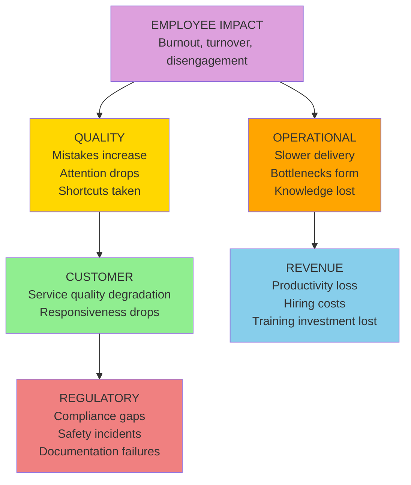

# D2: Employee Impact

> **Core Question:** How does this problem affect the people who work for us?

Employee impact is often the **most overlooked** dimension, yet it creates some of the most persistent cascades through quality degradation and knowledge loss.

**Most common next layer:** Employee → Revenue (in 31 of the 59 published cases where Employee is the origin)

## Observable Signals

Don't wait for resignations. Look for **early warning signals** in your systems:

| Signal Type | Observable | Data Source | Detection Speed |
|-------------|------------|-------------|-----------------|
| **Immediate** | Overtime hours spike | Timesheets, HRIS | Daily |
| **Behavioral** | Meeting no-shows | Calendar analytics | Days |
| **Sentiment** | Engagement score drop | Pulse surveys | Weekly |
| **Productivity** | Output decline | Project management tools | Weeks |
| **Turnover** | Resignation notices | HR system | Immediate |
| **Knowledge** | Bus factor = 1 | HEAT heatmap | Ongoing |
| **Health** | Sick day increase | HR data | Weeks |
| **Silent** | Reduced participation | Meeting notes, Slack activity | Weeks |

## Trigger Keywords

Language patterns indicate severity. Train your team to flag these:

### High Urgency (Sound = 8-10)

```
"I'm done"              "putting in notice"       "can't do this anymore"
"looking for other jobs" "burned out"             "hostile environment"
"discrimination"         "harassment"             "unsafe"
```

**Action:** Executive escalation within 1 hour.

### Medium Urgency (Sound = 4-7)

```
"overwhelmed"           "not sustainable"         "need help"
"understaffed"          "no work-life balance"    "thankless"
"underappreciated"      "dead end"               "no growth"
```

**Action:** Manager review within 24 hours.

### Low Urgency / Early Warning (Sound = 1-3)

```
"just curious about"    "any development opportunities"  "hypothetically"
"work from home policy" "how do other teams"             "is it just us"
```

**Action:** Track pattern over time.

## Metrics

Track **both** leading (predictive) and lagging (historical) indicators. The methodology does not supply targets or alert thresholds; set them from your own baseline.

| Metric Type | Metric Name | Calculation |
|-------------|-------------|-------------|
| **Leading** | Overtime hours | Hours > 40/week |
| **Leading** | Engagement pulse | Survey score (1-10) |
| **Leading** | Meeting attendance | Attended / Invited |
| **Leading** | PTO utilization | Days taken / Days available |
| **Lagging** | Voluntary turnover | Resignations / Headcount |
| **Lagging** | Time-to-fill | Days from req to hire |
| **Lagging** | Knowledge concentration | % of critical tasks with single owner |

### Example Dashboard Query

```sql
-- Overtime hours alert
SELECT
  employee_id,
  department,
  SUM(hours) - (COUNT(DISTINCT week) * 40) as overtime_hours,
  COUNT(DISTINCT week) as weeks_count
FROM timesheets
WHERE date >= CURRENT_DATE - INTERVAL '12 weeks'
GROUP BY employee_id, department
HAVING SUM(hours) - (COUNT(DISTINCT week) * 40) > (COUNT(DISTINCT week) * 4)  -- example threshold; set your own from your baseline
ORDER BY overtime_hours DESC
```

## Cascade Pathways

Employee impact can travel into other dimensions. The diagram shows common mechanisms; it is not a ranking. What the published case library actually records is counted below.



### What the Case Library Shows

In the [published library](https://uc-000.stratiqx.com) (331 cases with a recorded cascade, as of November 2026), Employee is the origin in 59. The next layer includes:

| Next layer includes | Cases (of 59) |
|---------------------|------------|
| Revenue | 31 |
| Operational | 27 |
| Quality | 18 |
| Customer | 13 |
| Regulatory | 7 |

A case can list several dimensions in one layer, so the counts add up to more than 59. These are counts of published cases, not probabilities.

- Employee is reached in some layer in 295 of 331 cases.
- Employee lands in the last layer in 132 of 331 cases.
- When Employee appears after the origin, the layer before it most often includes Customer (102 cases), Operational (100) and Revenue (89).

**How Employee strain reaches Quality:**

1. Burned-out employees make more mistakes (attention deficit)
2. They take shortcuts to manage workload (quality compromise)
3. They stop caring about excellence (engagement collapse)
4. They leave, taking institutional knowledge (quality inconsistency)

## How This Dimension Is Scored

Employee is scored 0-100 from cited evidence, like every dimension. Not every case scores all six.

Scoring belongs to CAL (spec v1.2.0, DOI [10.5281/zenodo.24090152](https://doi.org/10.5281/zenodo.24090152); concept DOI [10.5281/zenodo.18905196](https://doi.org/10.5281/zenodo.18905196)):

| Term | Definition |
|------|------------|
| **Chirp** | Average of the scored dimensions |
| **DRIFT** | \|Methodology − Performance\| |
| **Confidence** | The analyst's 0-1 rating of evidence quality |
| **FETCH** | Chirp × DRIFT × Confidence |

FETCH is compared with a threshold T (default 1,000). The level is **EXECUTE** at T or above (high priority at 2T or above), **CONFIRM** at 0.75T or above, **QUEUE** at 0.5T or above, and **WAIT** below that. A case's written verdict (EXECUTE, MONITOR, WATCH, COUNTER…) is the analyst's separate reading and can differ from the level. Prognostic cases also record triggers and review dates and are graded later.

Earlier versions of this page multiplied a direct cost by a "cascade multiplier" and attached a probability to each cascade path. No published case supports those numbers, so they were removed in 6D v2.0.0.

## 3D Scoring (Sound × Space × Time)

Apply the Cormorant Foraging lens to employee dimension:

| Lens | Score 1-3 | Score 4-6 | Score 7-10 |
|------|-----------|-----------|------------|
| **Sound (Urgency)** | Grumbling | Active complaints | Resignation |
| **Space (Scope)** | One person | One team | Cross-functional |
| **Time (Trajectory)** | Temporary stress | Sustained pressure | Chronic condition |

**Formula:** `Dimension Score = (Sound × Space × Time) ÷ 10`

### Example Scoring

**Scenario:** Entire engineering team complaining about unsustainable pace, pattern continuing for 3 months, first resignations submitted

```
Sound = 8 (resignations submitted)
Space = 7 (entire team affected)
Time = 7 (chronic, 3+ months)

Employee Impact Score = (8 × 7 × 7) ÷ 10 = 39.2
```

**Interpretation:** The 3D score describes how loud, how wide and how persistent the Employee signal is. It does not predict where the cascade goes next. For that, see what the case library records above.

## Detection Strategy

### Automated Monitoring

Set up alerts for (thresholds come from your own baseline):

1. **Overtime spike** (a rising share of the team on sustained overtime)
2. **Engagement drop** (pulse survey score falling below your baseline)
3. **Attendance decline** (meeting attendance falling)
4. **PTO underutilization** (people not taking the time they have)

### Human Intelligence

Train your managers to:

1. **Flag language patterns** (use trigger keyword lists)
2. **Monitor behavioral changes** (withdrawal, cynicism, reduced participation)
3. **Track knowledge concentration** (who owns what, bus factor analysis)
4. **Identify burnout signals** (overtime patterns, weekend work, vacation avoidance)

## Example Cases from the Library

Two published cases where Employee is the origin:

**[UC-320: Less Heads, More Heads](https://uc-320.stratiqx.com)**  
Cascade `D2>D3+D6`, listed as diagnostic. The cascade starts at Employee and ends at Revenue and Operational.

**[UC-341: Three Stars, Three Exits](https://uc-341.stratiqx.com)**  
Cascade `D2>D4+D3>D6+D1`, listed as diagnostic. The cascade starts at Employee, reaches Regulatory and Revenue, then ends at Operational and Customer.

Read each case for its evidence, scores and verdict. Browse the full library at [uc-000.stratiqx.com](https://uc-000.stratiqx.com).

## Industry Variations

### B2B SaaS

- **Primary metric:** Employee NPS (eNPS)
- **Key signal:** Engineering velocity decline (story points/sprint)
- **Cascade risk:** Employee → Quality → Customer

### Healthcare

- **Primary metric:** Nurse-to-patient ratio, shift overtime
- **Key signal:** Medical error rates, near-miss incidents
- **Cascade risk:** Employee → Quality → Regulatory → Customer (Patient)

### Manufacturing

- **Primary metric:** Safety incident rate, absenteeism
- **Key signal:** Production defect rate, downtime events
- **Cascade risk:** Employee → Quality → Operational → Revenue

## Next Steps

<div class="next-steps">

**📊 [D3: Revenue Impact](revenue.md)** — How employee issues drain productivity and increase costs

**🎯 [D5: Quality Impact](quality.md)** — How burnout shows up as defects and shortcuts

**🔄 [Cascade Analysis](../applications/cascade-analysis.md)** — Map how employee issues travel

**📖 [Observable Properties](../framework/observable-properties.md)** — Complete signal catalog

</div>

<style>
.next-steps {
  background: #161b22;
  padding: 2rem;
  border-radius: 12px;
  margin: 3rem 0;
  border-left: 4px solid #dda0dd;
}

.next-steps a {
  color: #58a6ff;
  text-decoration: none;
  font-weight: 600;
}

.next-steps a:hover {
  text-decoration: underline;
}
</style>

---

**Remember:** The employee who complains is asking for help. The employee who goes silent has already mentally quit. Track both. 🪶
