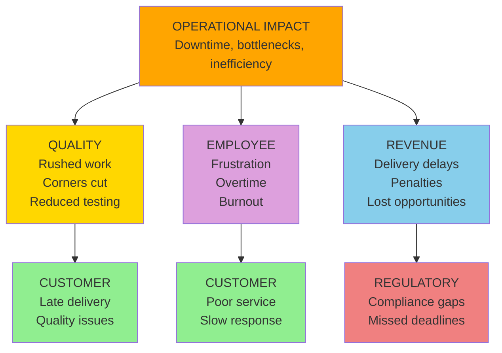

# D6: Operational Impact

> **Core Question:** How does this problem affect how we work?

Operational impact is often the **most pervasive** dimension. Inefficiencies and bottlenecks compound daily and drag on every other dimension. In the library it is reached in 312 of 331 published cases, more than any other dimension.

**Most common next layer:** Operational → Revenue (in 55 of the 74 published cases where Operational is the origin)

## Observable Signals

Don't wait for systems to crash. Look for **early warning signals** in your systems:

| Signal Type | Observable | Data Source | Detection Speed |
|-------------|------------|-------------|-----------------|
| **Immediate** | System downtime | Monitoring/APM | Minutes |
| **Behavioral** | Manual workarounds | Process documentation | Weeks |
| **Bottleneck** | Queue length increase | Workflow systems | Days |
| **Cycle** | Processing time up | Metrics dashboards | Days |
| **Resource** | Contention/Conflicts | Project management | Days |
| **Capacity** | Utilization spike | Resource planning | Days |
| **Silent** | Shadow processes | Interviews, observation | Months |
| **Integration** | Handoff failures | Cross-team metrics | Weeks |

## Trigger Keywords

Language patterns indicate severity. Train your team to flag these:

### High Urgency (Sound = 8-10)

```
"system down"           "outage"                  "critical failure"
"data loss"             "cannot operate"          "business stopped"
"disaster recovery"     "incident"                "P1/Sev1"
```

**Action:** Incident commander assigned within minutes. Executive notification.

### Medium Urgency (Sound = 4-7)

```
"workaround"            "manual process"          "bottleneck"
"waiting on"            "blocked by"              "delayed"
"capacity issue"        "resource conflict"       "slow"
```

**Action:** Manager review within 24 hours.

### Low Urgency / Early Warning (Sound = 1-3)

```
"inefficient"           "could be better"         "nice to have"
"tech debt"             "legacy system"           "someday"
"minor friction"        "slight delay"            "process improvement"
```

**Action:** Track pattern over time. Add to backlog.

## Metrics

Track **both** leading (predictive) and lagging (historical) indicators. The methodology does not supply targets or alert thresholds; set them from your own baseline.

| Metric Type | Metric Name | Calculation |
|-------------|-------------|-------------|
| **Leading** | System uptime | Available time / Total time |
| **Leading** | Cycle time | Time from start to completion |
| **Leading** | Queue depth | Items waiting / Processing rate |
| **Leading** | Resource utilization | Allocated / Available |
| **Lagging** | Incidents per period | Count of P1/P2 incidents |
| **Lagging** | Mean time to recovery | Avg incident resolution time |
| **Lagging** | Process efficiency | Value-add time / Total time |

### Example Dashboard Query

```sql
-- Queue depth anomaly alert
SELECT
  queue_name,
  COUNT(*) as current_depth,
  AVG(COUNT(*)) OVER (
    PARTITION BY queue_name
    ORDER BY date
    ROWS BETWEEN 30 PRECEDING AND 1 PRECEDING
  ) as baseline_30d,
  COUNT(*) / NULLIF(AVG(COUNT(*)) OVER (
    PARTITION BY queue_name
    ORDER BY date
    ROWS BETWEEN 30 PRECEDING AND 1 PRECEDING
  ), 0) as depth_ratio
FROM queue_metrics
WHERE timestamp >= CURRENT_DATE - INTERVAL '30 days'
GROUP BY queue_name, DATE(timestamp)
HAVING depth_ratio > 3  -- example threshold; set your own from your baseline
```

## Cascade Pathways

Operational impact can travel into other dimensions. The diagram shows common mechanisms; it is not a ranking. What the published case library actually records is counted below.



### What the Case Library Shows

In the [published library](https://uc-000.stratiqx.com) (331 cases with a recorded cascade, as of November 2026), Operational is the origin in 74. The next layer includes:

| Next layer includes | Cases (of 74) |
|---------------------|------------|
| Revenue | 55 |
| Quality | 35 |
| Customer | 33 |
| Employee | 11 |
| Regulatory | 11 |

A case can list several dimensions in one layer, so the counts add up to more than 74. These are counts of published cases, not probabilities.

- Operational is reached in some layer in 312 of 331 cases.
- Operational lands in the last layer in 33 of 331 cases.
- When Operational appears after the origin, the layer before it most often includes Revenue (103 cases), Quality (76) and Customer (46).

**How Operational reaches Quality:**

1. Time pressure forces shortcuts (testing skipped, reviews rushed)
2. Resource constraints limit thoroughness (fewer QA cycles)
3. Workarounds become permanent (technical debt accumulates)
4. Focus shifts to "getting it done" vs "getting it right" (quality culture erodes)

## How This Dimension Is Scored

Operational is scored 0-100 from cited evidence, like every dimension. Not every case scores all six.

Scoring belongs to CAL (spec v1.2.0, DOI [10.5281/zenodo.24090152](https://doi.org/10.5281/zenodo.24090152); concept DOI [10.5281/zenodo.18905196](https://doi.org/10.5281/zenodo.18905196)):

| Term | Definition |
|------|------------|
| **Chirp** | Average of the scored dimensions |
| **DRIFT** | \|Methodology − Performance\| |
| **Confidence** | The analyst's 0-1 rating of evidence quality |
| **FETCH** | Chirp × DRIFT × Confidence |

FETCH is compared with a threshold T (default 1,000). The level is **EXECUTE** at T or above (high priority at 2T or above), **CONFIRM** at 0.75T or above, **QUEUE** at 0.5T or above, and **WAIT** below that. A case's written verdict (EXECUTE, MONITOR, WATCH, COUNTER…) is the analyst's separate reading and can differ from the level. Prognostic cases also record triggers and review dates and are graded later.

Earlier versions of this page multiplied a direct cost by a "cascade multiplier" and attached a probability to each cascade path. No published case supports those numbers, so they were removed in 6D v2.0.0.

## 3D Scoring (Sound × Space × Time)

Apply the Cormorant Foraging lens to operational dimension:

| Lens | Score 1-3 | Score 4-6 | Score 7-10 |
|------|-----------|-----------|------------|
| **Sound (Urgency)** | Efficiency opportunity | Bottleneck | System down |
| **Space (Scope)** | One process | One department | Cross-functional |
| **Time (Trajectory)** | Temporary spike | Recurring issue | Chronic condition |

**Formula:** `Dimension Score = (Sound × Space × Time) ÷ 10`

### Example Scoring

**Scenario:** Deployment process bottleneck affecting all engineering teams, recurring every sprint for 6 months

```
Sound = 6 (bottleneck, slowing releases)
Space = 8 (all engineering teams)
Time = 7 (chronic, 6+ months)

Operational Impact Score = (6 × 8 × 7) ÷ 10 = 33.6
```

**Interpretation:** The 3D score describes how loud, how wide and how persistent the Operational signal is. It does not predict where the cascade goes next. For that, see what the case library records above.

## Detection Strategy

### Automated Monitoring

Set up alerts for (thresholds come from your own baseline):

1. **System uptime** (availability below your service level)
2. **Cycle time increase** (against your baseline)
3. **Queue depth spike** (well above normal)
4. **Resource utilization extremes** (teams running near full or sitting idle)

### Human Intelligence

Train your operations/engineering teams to:

1. **Flag language patterns** (use trigger keyword lists)
2. **Report workarounds** (manual processes hiding automation failures)
3. **Escalate bottlenecks** (blocked work, waiting states)
4. **Track handoff failures** (cross-team coordination issues)

## Example Cases from the Library

Two published cases where Operational is the origin:

**[UC-319: The Fleet Doubled. The Coverage Didn't](https://uc-319.stratiqx.com)**  
Cascade `D6>D3+D5`, listed as diagnostic. The cascade starts at Operational and ends at Revenue and Quality.

**[UC-336: How to Read a Book You Can't Open](https://uc-336.stratiqx.com)**  
Cascade `D6>D2+D5>D4+D1`, listed as amplifying. The cascade starts at Operational, reaches Employee and Quality, then ends at Regulatory and Customer.

Read each case for its evidence, scores and verdict. Browse the full library at [uc-000.stratiqx.com](https://uc-000.stratiqx.com).

## Industry Variations

### B2B SaaS

- **Primary metric:** Deployment frequency, lead time for changes
- **Key signal:** Production incidents, rollback rate
- **Cascade risk:** Operational → Quality → Customer

### Healthcare

- **Primary metric:** Patient wait time, bed turnover rate
- **Key signal:** Staffing shortages, equipment downtime
- **Cascade risk:** Operational → Quality → Customer (Patient) → Regulatory

### Manufacturing

- **Primary metric:** Overall Equipment Effectiveness (OEE), cycle time
- **Key signal:** Machine downtime, changeover time, inventory levels
- **Cascade risk:** Operational → Quality → Revenue → Customer

## Next Steps

<div class="next-steps">

**📊 [D5: Quality Impact](quality.md)** — How time pressure turns into shortcuts and defects

**👥 [D2: Employee Impact](employee.md)** — How operational bottlenecks burn out teams

**🔄 [Cascade Analysis](../applications/cascade-analysis.md)** — Map how operational issues travel

**📖 [Observable Properties](../framework/observable-properties.md)** — Complete signal catalog

</div>

<style>
.next-steps {
  background: #161b22;
  padding: 2rem;
  border-radius: 12px;
  margin: 3rem 0;
  border-left: 4px solid #ffa500;
}

.next-steps a {
  color: #58a6ff;
  text-decoration: none;
  font-weight: 600;
}

.next-steps a:hover {
  text-decoration: underline;
}
</style>

---

**Remember:** The bottleneck you ignore becomes the ceiling. The workaround you tolerate becomes the process. Fix both. 🪶
