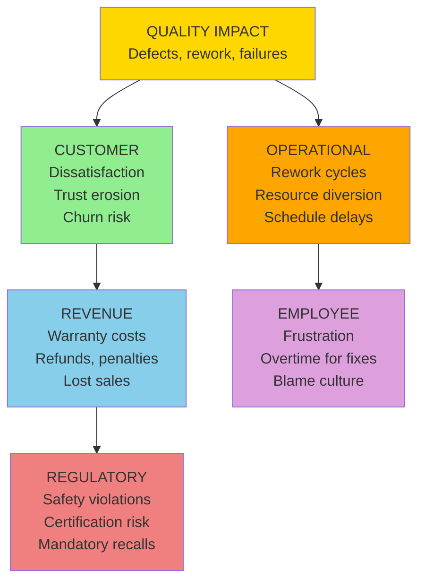

# D5: Quality Impact

> **Core Question:** How does this problem affect what we deliver?

Quality impact is often the **most insidious** dimension. A defect found internally is a fix; a defect found by a customer, or one that causes harm, is a cascade.

**Most common next layer:** Quality → Operational (in 45 of the 81 published cases where Quality is the origin)

## Observable Signals

Don't wait for customer complaints. Look for **early warning signals** in your systems:

| Signal Type | Observable | Data Source | Detection Speed |
|-------------|------------|-------------|-----------------|
| **Immediate** | Defect rate spike | QA system | Hours-Days |
| **Behavioral** | Rework hours increase | Timesheets | Days |
| **Customer** | Complaint volume up | Support system | Days |
| **Safety** | Incident reports | EHS system | Immediate |
| **Returns** | Product returns | Logistics/RMA | Days |
| **Process** | Specification deviations | Quality audits | Weeks |
| **Silent** | Workarounds created | Tribal knowledge, interviews | Months |
| **Inspection** | Rejection rate | Manufacturing QC | Immediate |

## Trigger Keywords

Language patterns indicate severity. Train your team to flag these:

### High Urgency (Sound = 8-10)

```
"recall"                "safety incident"         "injury"
"critical defect"       "system failure"          "data breach"
"contamination"         "fatality"                "major outage"
```

**Action:** Executive escalation within 1 hour. Potential regulatory notification.

### Medium Urgency (Sound = 4-7)

```
"defect"                "rework"                  "redo"
"didn't meet spec"      "out of tolerance"        "failed inspection"
"customer complaint"    "return"                  "warranty claim"
```

**Action:** Manager review within 24 hours.

### Low Urgency / Early Warning (Sound = 1-3)

```
"workaround"            "manual fix"              "known issue"
"tech debt"             "legacy limitation"       "needs improvement"
"minor issue"           "cosmetic defect"         "edge case"
```

**Action:** Track pattern over time. Add to backlog.

## Metrics

Track **both** leading (predictive) and lagging (historical) indicators. The methodology does not supply targets or alert thresholds; set them from your own baseline.

| Metric Type | Metric Name | Calculation |
|-------------|-------------|-------------|
| **Leading** | First-pass yield | Good units / Total units |
| **Leading** | Defect detection rate | Defects found internally / Total |
| **Leading** | Code coverage | % of code with tests |
| **Leading** | Technical debt ratio | Debt remediation time / Dev time |
| **Lagging** | Customer-reported defects | Count per release/period |
| **Lagging** | Cost of quality | Prevention + Appraisal + Failure costs |
| **Lagging** | Warranty costs | Claims / Revenue |

### Example Dashboard Query

```sql
-- Defect detection rate alert
SELECT
  release_version,
  COUNT(CASE WHEN found_by = 'Internal' THEN 1 END) as internal_defects,
  COUNT(CASE WHEN found_by = 'Customer' THEN 1 END) as customer_defects,
  COUNT(CASE WHEN found_by = 'Internal' THEN 1 END) * 100.0 /
    NULLIF(COUNT(*), 0) as detection_rate_pct
FROM defects
WHERE created_date >= CURRENT_DATE - INTERVAL '90 days'
GROUP BY release_version
HAVING detection_rate_pct < 80  -- example threshold; set your own from your baseline
ORDER BY created_date DESC
```

## Cascade Pathways

Quality impact can travel into other dimensions. The diagram shows common mechanisms; it is not a ranking. What the published case library actually records is counted below.



### What the Case Library Shows

In the [published library](https://uc-000.stratiqx.com) (331 cases with a recorded cascade, as of November 2026), Quality is the origin in 81. The next layer includes:

| Next layer includes | Cases (of 81) |
|---------------------|------------|
| Operational | 45 |
| Revenue | 39 |
| Customer | 29 |
| Regulatory | 13 |
| Employee | 12 |

A case can list several dimensions in one layer, so the counts add up to more than 81. These are counts of published cases, not probabilities.

- Quality is reached in some layer in 294 of 331 cases.
- Quality lands in the last layer in 49 of 331 cases.
- When Quality appears after the origin, the layer before it most often includes Operational (108 cases), Revenue (91) and Customer (74).

**How Quality reaches Customer:**

1. Defects directly impact user experience (functionality, reliability)
2. Quality issues erode trust (perception of brand/product)
3. Customers amplify problems (reviews, social media, word-of-mouth)
4. Competitive alternatives exist (switching is easier than tolerating defects)

## How This Dimension Is Scored

Quality is scored 0-100 from cited evidence, like every dimension. Not every case scores all six.

Scoring belongs to CAL (spec v1.2.0, DOI [10.5281/zenodo.24090152](https://doi.org/10.5281/zenodo.24090152); concept DOI [10.5281/zenodo.18905196](https://doi.org/10.5281/zenodo.18905196)):

| Term | Definition |
|------|------------|
| **Chirp** | Average of the scored dimensions |
| **DRIFT** | \|Methodology − Performance\| |
| **Confidence** | The analyst's 0-1 rating of evidence quality |
| **FETCH** | Chirp × DRIFT × Confidence |

FETCH is compared with a threshold T (default 1,000). The level is **EXECUTE** at T or above (high priority at 2T or above), **CONFIRM** at 0.75T or above, **QUEUE** at 0.5T or above, and **WAIT** below that. A case's written verdict (EXECUTE, MONITOR, WATCH, COUNTER…) is the analyst's separate reading and can differ from the level. Prognostic cases also record triggers and review dates and are graded later.

Earlier versions of this page multiplied a direct cost by a "cascade multiplier" and attached a probability to each cascade path. No published case supports those numbers, so they were removed in 6D v2.0.0.

## 3D Scoring (Sound × Space × Time)

Apply the Cormorant Foraging lens to quality dimension:

| Lens | Score 1-3 | Score 4-6 | Score 7-10 |
|------|-----------|-----------|------------|
| **Sound (Urgency)** | Cosmetic issue | Functional defect | Safety critical |
| **Space (Scope)** | One unit | Batch/Release | All production |
| **Time (Trajectory)** | Isolated incident | Recurring | Systemic/Chronic |

**Formula:** `Dimension Score = (Sound × Space × Time) ÷ 10`

### Example Scoring

**Scenario:** Critical software bug affecting all users on production, recurring in every release despite fixes

```
Sound = 9 (system failure, data loss risk)
Space = 9 (all production users)
Time = 7 (recurring, systemic root cause)

Quality Impact Score = (9 × 9 × 7) ÷ 10 = 56.7
```

**Interpretation:** The 3D score describes how loud, how wide and how persistent the Quality signal is. It does not predict where the cascade goes next. For that, see what the case library records above.

## Detection Strategy

### Automated Monitoring

Set up alerts for (thresholds come from your own baseline):

1. **Defect rate spike** (a week-over-week increase)
2. **First-pass yield drop** (fewer good units than your baseline)
3. **Customer-reported defects** (a rising share of defects found by customers)
4. **Rework hours** (a rising share of development time spent on rework)

### Human Intelligence

Train your QA/engineering teams to:

1. **Flag language patterns** (use trigger keyword lists)
2. **Report workarounds** (band-aids hiding systemic issues)
3. **Escalate safety concerns** (near-misses are signals)
4. **Track customer sentiment** (quality perception vs metrics)

## Example Cases from the Library

Two published cases where Quality is the origin:

**[UC-339: Two Machines, One Hypothesis](https://uc-339.stratiqx.com)**  
Cascade `D5>D6+D2>D4+D1`, listed as amplifying. The cascade starts at Quality, reaches Operational and Employee, then ends at Regulatory and Customer.

**[UC-338: Translation Was Never the Hard Part](https://uc-338.stratiqx.com)**  
Cascade `D5>D3+D6>D2+D1`, listed as diagnostic. The cascade starts at Quality, reaches Revenue and Operational, then ends at Employee and Customer.

Read each case for its evidence, scores and verdict. Browse the full library at [uc-000.stratiqx.com](https://uc-000.stratiqx.com).

## Industry Variations

### B2B SaaS

- **Primary metric:** Bug escape rate, mean time to resolution
- **Key signal:** Customer-reported defects, production incidents
- **Cascade risk:** Quality → Customer → Revenue

### Healthcare

- **Primary metric:** Medication errors, patient safety incidents
- **Key signal:** Near-miss reports, adverse events
- **Cascade risk:** Quality → Regulatory → Customer (Patient) → Revenue

### Manufacturing

- **Primary metric:** First-pass yield, defect parts per million (DPPM)
- **Key signal:** Scrap rate, rework hours, customer returns
- **Cascade risk:** Quality → Customer → Revenue → Regulatory

## Next Steps

<div class="next-steps">

**📊 [D1: Customer Impact](customer.md)** — How defects turn into customer dissatisfaction

**🔧 [D6: Operational Impact](operational.md)** — Operational is the most common next layer after Quality

**🔄 [Cascade Analysis](../applications/cascade-analysis.md)** — Map how quality issues travel

**📖 [Observable Properties](../framework/observable-properties.md)** — Complete signal catalog

</div>

<style>
.next-steps {
  background: #161b22;
  padding: 2rem;
  border-radius: 12px;
  margin: 3rem 0;
  border-left: 4px solid #ffd700;
}

.next-steps a {
  color: #58a6ff;
  text-decoration: none;
  font-weight: 600;
}

.next-steps a:hover {
  text-decoration: underline;
}
</style>

---

**Remember:** The defect you find is fixable. The defect your customer finds is expensive. The defect that causes harm is catastrophic. Find them first. 🪶
