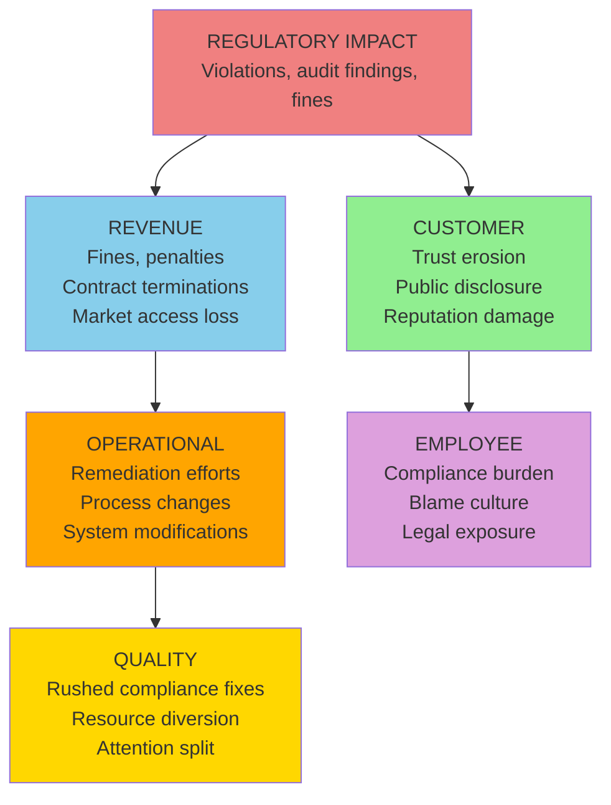

# D4: Regulatory Impact

> **Core Question:** How does this problem affect our compliance and legal standing?

Regulatory impact is often the **most consequential** dimension when public disclosure or criminal penalties are involved. It is also where cascades most often end: Regulatory lands in the last layer in 158 of 331 published cases, more than any other dimension.

**Most common next layer:** Regulatory → Revenue (in 36 of the 57 published cases where Regulatory is the origin)

## Observable Signals

Don't wait for auditor findings. Look for **early warning signals** in your systems:

| Signal Type | Observable | Data Source | Detection Speed |
|-------------|------------|-------------|-----------------|
| **Immediate** | Audit finding | Compliance reports | Days |
| **Behavioral** | Documentation gaps | Process audits | Weeks |
| **Violation** | Non-compliance notice | Legal/Compliance | Immediate |
| **Exposure** | Missing certifications | Compliance tracker | Monthly |
| **Training** | Expired certifications | LMS/HR system | Ongoing |
| **Process** | Deviation from standard | Quality reviews | Weeks |
| **Silent** | Policy not followed | Internal audits | Months |
| **External** | Regulatory inquiry | Legal department | Immediate |

## Trigger Keywords

Language patterns indicate severity. Train your team to flag these:

### High Urgency (Sound = 8-10)

```
"violation"             "fine"                    "penalty"
"cease and desist"      "investigation"           "lawsuit"
"material weakness"     "regulatory action"       "license suspended"
"criminal"              "fraud"                   "subpoena"
```

**Action:** Executive and legal escalation within 1 hour.

### Medium Urgency (Sound = 4-7)

```
"audit finding"         "non-compliance"          "remediation required"
"certification gap"     "documentation missing"   "policy violation"
"deadline approaching"  "renewal pending"         "inspection scheduled"
```

**Action:** Compliance manager review within 24 hours.

### Low Urgency / Early Warning (Sound = 1-3)

```
"new regulation"        "industry guidance"       "best practice"
"peer comparison"       "voluntary disclosure"    "proactive review"
```

**Action:** Track pattern over time, update compliance calendar.

## Metrics

Track **both** leading (predictive) and lagging (historical) indicators. The methodology does not supply targets or alert thresholds; set them from your own baseline.

| Metric Type | Metric Name | Calculation |
|-------------|-------------|-------------|
| **Leading** | Open audit findings | Count of unresolved |
| **Leading** | Certification currency | Days until expiration |
| **Leading** | Policy acknowledgment | % of employees current |
| **Leading** | Training completion | Required training % |
| **Lagging** | Regulatory fines | Dollar amount / year |
| **Lagging** | Audit opinion | Clean / Qualified / Adverse |
| **Lagging** | Compliance incidents | Count per year |

### Example Dashboard Query

```sql
-- Certification expiration alert
SELECT
  certification_type,
  employee_name,
  department,
  expiration_date,
  DATEDIFF(day, CURRENT_DATE, expiration_date) as days_until_expiration
FROM certifications
WHERE expiration_date <= CURRENT_DATE + INTERVAL '90 days'
  AND status = 'Active'
ORDER BY expiration_date ASC
```

## Cascade Pathways

Regulatory impact can travel into other dimensions. The diagram shows common mechanisms; it is not a ranking. What the published case library actually records is counted below.



### What the Case Library Shows

In the [published library](https://uc-000.stratiqx.com) (331 cases with a recorded cascade, as of November 2026), Regulatory is the origin in 57. The next layer includes:

| Next layer includes | Cases (of 57) |
|---------------------|------------|
| Revenue | 36 |
| Operational | 29 |
| Customer | 25 |
| Quality | 14 |
| Employee | 11 |

A case can list several dimensions in one layer, so the counts add up to more than 57. These are counts of published cases, not probabilities.

- Regulatory is reached in some layer in 285 of 331 cases.
- Regulatory lands in the last layer in 158 of 331 cases.
- When Regulatory appears after the origin, the layer before it most often includes Revenue (91 cases), Quality (90) and Operational (82).

**How Regulatory reaches Revenue:**

1. Direct fines and penalties (immediate cash impact)
2. Contract termination clauses (customer exits)
3. Market access restrictions (lost opportunities)
4. Insurance premium increases (ongoing costs)

## How This Dimension Is Scored

Regulatory is scored 0-100 from cited evidence, like every dimension. Not every case scores all six.

Scoring belongs to CAL (spec v1.2.0, DOI [10.5281/zenodo.24090152](https://doi.org/10.5281/zenodo.24090152); concept DOI [10.5281/zenodo.18905196](https://doi.org/10.5281/zenodo.18905196)):

| Term | Definition |
|------|------------|
| **Chirp** | Average of the scored dimensions |
| **DRIFT** | \|Methodology − Performance\| |
| **Confidence** | The analyst's 0-1 rating of evidence quality |
| **FETCH** | Chirp × DRIFT × Confidence |

FETCH is compared with a threshold T (default 1,000). The level is **EXECUTE** at T or above (high priority at 2T or above), **CONFIRM** at 0.75T or above, **QUEUE** at 0.5T or above, and **WAIT** below that. A case's written verdict (EXECUTE, MONITOR, WATCH, COUNTER…) is the analyst's separate reading and can differ from the level. Prognostic cases also record triggers and review dates and are graded later.

Earlier versions of this page multiplied a direct cost by a "cascade multiplier" and attached a probability to each cascade path. No published case supports those numbers, so they were removed in 6D v2.0.0.

## 3D Scoring (Sound × Space × Time)

Apply the Cormorant Foraging lens to regulatory dimension:

| Lens | Score 1-3 | Score 4-6 | Score 7-10 |
|------|-----------|-----------|------------|
| **Sound (Urgency)** | Best practice gap | Audit finding | Active investigation |
| **Space (Scope)** | One process | One department | Enterprise-wide |
| **Time (Trajectory)** | First instance | Pattern emerging | Chronic non-compliance |

**Formula:** `Dimension Score = (Sound × Space × Time) ÷ 10`

### Example Scoring

**Scenario:** SEC audit finding affecting financial reporting across all divisions, pattern of similar issues over 3 years

```
Sound = 9 (active SEC investigation)
Space = 9 (enterprise-wide financial reporting)
Time = 8 (chronic, 3+ years)

Regulatory Impact Score = (9 × 9 × 8) ÷ 10 = 64.8
```

**Interpretation:** The 3D score describes how loud, how wide and how persistent the Regulatory signal is. It does not predict where the cascade goes next. For that, see what the case library records above.

## Detection Strategy

### Automated Monitoring

Set up alerts for (thresholds come from your own baseline):

1. **Audit finding closure** (a critical finding left open)
2. **Certification expiration** (a required certification approaching its expiry date)
3. **Training compliance** (required training below full completion)
4. **Policy acknowledgment** (current acknowledgments falling)

### Human Intelligence

Train your compliance/legal teams to:

1. **Flag language patterns** (use trigger keyword lists)
2. **Monitor regulatory changes** (new laws, industry guidance)
3. **Track industry incidents** (peer violations as warning)
4. **Escalate near-misses** (close calls are signals)

## Example Cases from the Library

Two published cases where Regulatory is the origin:

**[UC-337: Old Because It Was Free](https://uc-337.stratiqx.com)**  
Cascade `D4>D6+D3>D5+D1`, listed as diagnostic. The cascade starts at Regulatory, reaches Operational and Revenue, then ends at Quality and Customer.

**[UC-326: The Stick Tariff Is a Liquor Tariff](https://uc-326.stratiqx.com)**  
Cascade `D4>D6+D3>D1+D2`, listed as diagnostic. The cascade starts at Regulatory, reaches Operational and Revenue, then ends at Customer and Employee.

Read each case for its evidence, scores and verdict. Browse the full library at [uc-000.stratiqx.com](https://uc-000.stratiqx.com).

## Industry Variations

### Financial Services

- **Primary metric:** Audit findings, regulatory exam results
- **Key signal:** Transaction monitoring alerts, suspicious activity reports
- **Cascade risk:** Regulatory → Revenue → Customer → Operational

### Healthcare

- **Primary metric:** HIPAA compliance, accreditation status
- **Key signal:** Patient privacy incidents, documentation gaps
- **Cascade risk:** Regulatory → Revenue → Customer (Patient) → Employee

### Manufacturing

- **Primary metric:** OSHA recordable incidents, EPA violations
- **Key signal:** Safety near-misses, environmental exceedances
- **Cascade risk:** Regulatory → Operational → Quality → Revenue

## Next Steps

<div class="next-steps">

**📊 [D3: Revenue Impact](revenue.md)** — Revenue is the most common next layer after Regulatory

**👥 [D1: Customer Impact](customer.md)** — How regulatory issues erode trust

**🔄 [Cascade Analysis](../applications/cascade-analysis.md)** — Map how regulatory issues travel

**📖 [Observable Properties](../framework/observable-properties.md)** — Complete signal catalog

</div>

<style>
.next-steps {
  background: #161b22;
  padding: 2rem;
  border-radius: 12px;
  margin: 3rem 0;
  border-left: 4px solid #f08080;
}

.next-steps a {
  color: #58a6ff;
  text-decoration: none;
  font-weight: 600;
}

.next-steps a:hover {
  text-decoration: underline;
}
</style>

---

**Remember:** The audit finding you dismiss is a warning. The pattern you ignore becomes a headline. Address both. 🪶
