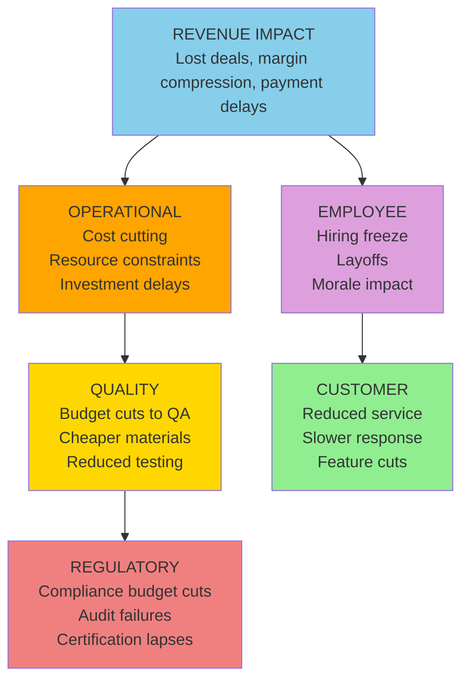

# D3: Revenue Impact

> **Core Question:** How does this problem affect money coming in?

Revenue impact is often the **most measured** dimension, but leading indicators are frequently missed until deals are already lost.

**Most common next layer:** Revenue → Operational (in 65 of the 96 published cases where Revenue is the origin)

## Observable Signals

Don't wait for quarterly reports. Look for **early warning signals** in your systems:

| Signal Type | Observable | Data Source | Detection Speed |
|-------------|------------|-------------|-----------------|
| **Immediate** | Invoice disputes | AR aging report | Days |
| **Behavioral** | Discount requests | Sales CRM | Days |
| **Pipeline** | Deal slippage | Forecast system | Weekly |
| **Penalty** | SLA breach payments | Contract management | Immediate |
| **Opportunity** | Lost bids | Sales post-mortems | Days |
| **Pricing** | Margin compression | Financial reports | Monthly |
| **Cash** | Payment cycle lengthening | Cash flow analysis | Weeks |
| **Silent** | Upsell/cross-sell decline | Revenue analytics | Months |

## Trigger Keywords

Language patterns indicate severity. Train your team to flag these:

### High Urgency (Sound = 8-10)

```
"penalty clause"        "breach of contract"      "demand refund"
"termination"           "lawsuit"                 "material breach"
"audit finding"         "revenue restatement"     "write-off"
```

**Action:** Executive escalation within 1 hour.

### Medium Urgency (Sound = 4-7)

```
"renegotiate"           "discount"                "credit"
"delayed payment"       "budget cut"              "procurement review"
"competitive bid"       "price matching"          "cost reduction"
```

**Action:** Manager review within 24 hours.

### Low Urgency / Early Warning (Sound = 1-3)

```
"next fiscal year"      "budget planning"         "exploring options"
"market conditions"     "strategic review"        "benchmarking"
```

**Action:** Track pattern over time.

## Metrics

Track **both** leading (predictive) and lagging (historical) indicators. The methodology does not supply targets or alert thresholds; set them from your own baseline.

| Metric Type | Metric Name | Calculation |
|-------------|-------------|-------------|
| **Leading** | Pipeline velocity | Days in stage vs benchmark |
| **Leading** | Discount rate | Avg discount % on closed deals |
| **Leading** | AR aging | % of receivables >60 days |
| **Leading** | Forecast accuracy | Actual / Forecasted |
| **Lagging** | Revenue growth | YoY change |
| **Lagging** | Gross margin | (Revenue - COGS) / Revenue |
| **Lagging** | Revenue per employee | Total revenue / Headcount |

### Example Dashboard Query

```sql
-- Pipeline velocity alert
SELECT
  stage_name,
  AVG(DATEDIFF(day, stage_entered, stage_exited)) as avg_days_in_stage,
  benchmark_days,
  (AVG(DATEDIFF(day, stage_entered, stage_exited)) / benchmark_days) as velocity_ratio
FROM opportunities o
JOIN stage_benchmarks b ON o.stage_name = b.stage_name
WHERE o.close_date >= CURRENT_DATE - INTERVAL '90 days'
GROUP BY stage_name, benchmark_days
HAVING velocity_ratio > 1.5  -- example threshold; set your own from your baseline
```

## Cascade Pathways

Revenue impact can travel into other dimensions. The diagram shows common mechanisms; it is not a ranking. What the published case library actually records is counted below.



### What the Case Library Shows

In the [published library](https://uc-000.stratiqx.com) (331 cases with a recorded cascade, as of November 2026), Revenue is the origin in 96. The next layer includes:

| Next layer includes | Cases (of 96) |
|---------------------|------------|
| Operational | 65 |
| Customer | 43 |
| Quality | 32 |
| Regulatory | 20 |
| Employee | 16 |

A case can list several dimensions in one layer, so the counts add up to more than 96. These are counts of published cases, not probabilities.

- Revenue is reached in some layer in 304 of 331 cases.
- Revenue lands in the last layer in 18 of 331 cases.
- When Revenue appears after the origin, the layer before it most often includes Operational (74 cases), Quality (62) and Customer (50).

Revenue is the most common origin in the library: 96 cases start there, more than any other dimension.

**How Revenue reaches Operational:**

1. Revenue shortfall triggers immediate cost-cutting (operational constraints)
2. Planned investments get delayed (infrastructure debt accumulates)
3. Resources get reallocated (priorities shift, projects stall)
4. Efficiency pressure increases (processes get optimized, sometimes poorly)

## How This Dimension Is Scored

Revenue is scored 0-100 from cited evidence, like every dimension. Not every case scores all six.

Scoring belongs to CAL (spec v1.2.0, DOI [10.5281/zenodo.24090152](https://doi.org/10.5281/zenodo.24090152); concept DOI [10.5281/zenodo.18905196](https://doi.org/10.5281/zenodo.18905196)):

| Term | Definition |
|------|------------|
| **Chirp** | Average of the scored dimensions |
| **DRIFT** | \|Methodology − Performance\| |
| **Confidence** | The analyst's 0-1 rating of evidence quality |
| **FETCH** | Chirp × DRIFT × Confidence |

FETCH is compared with a threshold T (default 1,000). The level is **EXECUTE** at T or above (high priority at 2T or above), **CONFIRM** at 0.75T or above, **QUEUE** at 0.5T or above, and **WAIT** below that. A case's written verdict (EXECUTE, MONITOR, WATCH, COUNTER…) is the analyst's separate reading and can differ from the level. Prognostic cases also record triggers and review dates and are graded later.

Earlier versions of this page multiplied a direct cost by a "cascade multiplier" and attached a probability to each cascade path. No published case supports those numbers, so they were removed in 6D v2.0.0.

## 3D Scoring (Sound × Space × Time)

Apply the Cormorant Foraging lens to revenue dimension:

| Lens | Score 1-3 | Score 4-6 | Score 7-10 |
|------|-----------|-----------|------------|
| **Sound (Urgency)** | Future risk | Current quarter impact | Immediate cash crisis |
| **Space (Scope)** | One deal | Product line | Company-wide |
| **Time (Trajectory)** | One-time hit | Quarterly pattern | Structural decline |

**Formula:** `Dimension Score = (Sound × Space × Time) ÷ 10`

### Example Scoring

**Scenario:** Multiple enterprise deals slipping, affecting entire product line, pattern emerging over 2 quarters

```
Sound = 7 (current quarter miss imminent)
Space = 8 (product line-wide issue)
Time = 6 (pattern over 2 quarters)

Revenue Impact Score = (7 × 8 × 6) ÷ 10 = 33.6
```

**Interpretation:** The 3D score describes how loud, how wide and how persistent the Revenue signal is. It does not predict where the cascade goes next. For that, see what the case library records above.

## Detection Strategy

### Automated Monitoring

Set up alerts for (thresholds come from your own baseline):

1. **Pipeline velocity anomaly** (deals sitting in a stage well past its benchmark)
2. **Discount rate spike** (average discount on closed deals rising)
3. **AR aging deterioration** (a growing share of receivables past 60 days)
4. **Forecast accuracy decline** (actuals drifting away from forecast)

### Human Intelligence

Train your sales/finance teams to:

1. **Flag language patterns** (use trigger keyword lists)
2. **Report pricing pressure** (competitive bids, discount requests)
3. **Escalate payment delays** (customer cash flow issues as early warning)
4. **Track win/loss patterns** (competitive intelligence, market shifts)

## Example Cases from the Library

Two published cases where Revenue is the origin:

**[UC-324: Full Rebuild](https://uc-324.stratiqx.com)**  
Cascade `D3>D6+D2>D5+D1`, listed as diagnostic. The cascade starts at Revenue, reaches Operational and Employee, then ends at Quality and Customer.

**[UC-322: $53 Billion Passed, $8 Billion Spent](https://uc-322.stratiqx.com)**  
Cascade `D3>D6+D1`, listed as diagnostic. The cascade starts at Revenue and ends at Operational and Customer.

Read each case for its evidence, scores and verdict. Browse the full library at [uc-000.stratiqx.com](https://uc-000.stratiqx.com).

## Industry Variations

### B2B SaaS

- **Primary metric:** Annual Recurring Revenue (ARR), Net Revenue Retention (NRR)
- **Key signal:** Churn rate, expansion rate, sales cycle length
- **Cascade risk:** Revenue → Operational → Quality

### Professional Services

- **Primary metric:** Utilization rate, realization rate
- **Key signal:** Unbilled hours, scope creep, client concentration
- **Cascade risk:** Revenue → Employee → Quality → Customer

### Retail/E-commerce

- **Primary metric:** Same-store sales, customer acquisition cost (CAC)
- **Key signal:** Basket size, conversion rate, return rate
- **Cascade risk:** Revenue → Operational → Customer

## Next Steps

<div class="next-steps">

**📊 [D6: Operational Impact](operational.md)** — Operational is the most common next layer after Revenue

**👥 [D2: Employee Impact](employee.md)** — How revenue pressure affects hiring and morale

**🔄 [Cascade Analysis](../applications/cascade-analysis.md)** — Map how revenue issues travel

**📖 [Observable Properties](../framework/observable-properties.md)** — Complete signal catalog

</div>

<style>
.next-steps {
  background: #161b22;
  padding: 2rem;
  border-radius: 12px;
  margin: 3rem 0;
  border-left: 4px solid #87ceeb;
}

.next-steps a {
  color: #58a6ff;
  text-decoration: none;
  font-weight: 600;
}

.next-steps a:hover {
  text-decoration: underline;
}
</style>

---

**Remember:** The deal that slips is telling you something. The pattern that repeats is screaming. Listen to both. 🪶
