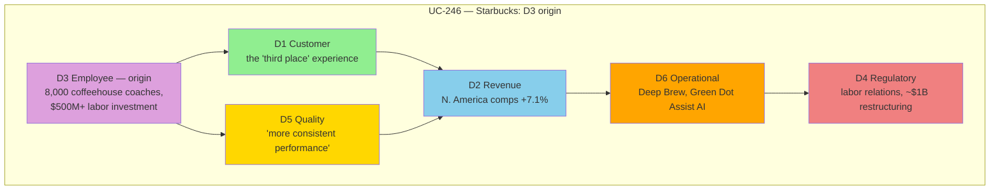

# Cascade Pathways

> **"Every problem starts in one dimension. Smart analysis tracks where it spreads."**

Problems don't stay contained. A billing error becomes customer churn. Employee burnout creates quality issues. Understanding **cascade pathways** lets you see where a problem actually spreads before it's happened everywhere at once.

## The Core Principle

**Cascade propagation:** A problem in one dimension triggers impacts in other dimensions, each with its own severity, evidence, and (often) its own citations.

**Why this matters:**
- The origin dimension is what's visible. The cascade is what's usually missed.
- Most analysis stops at the origin dimension.
- The full picture lives in how far — and where — the cascade actually reaches.

## CASCADE PATHWAY MASTER MAP

```
                         ┌─────────────────────────────────────────────────┐
                         │              PROBLEM ORIGIN                      │
                         │         (Identify starting dimension)            │
                         └─────────────────────────┬───────────────────────┘
                                                   │
           ┌───────────────────────────────────────┼───────────────────────────────────────┐
           │                                       │                                       │
           ▼                                       ▼                                       ▼
    ┌─────────────┐                        ┌─────────────┐                        ┌─────────────┐
    │  CUSTOMER   │◄──────────────────────►│  EMPLOYEE   │◄──────────────────────►│  REVENUE    │
    │     D1      │                        │     D2      │                        │     D3      │
    └──────┬──────┘                        └──────┬──────┘                        └──────┬──────┘
           │                                      │                                      │
           │         ┌────────────────────────────┼────────────────────────────┐         │
           │         │                            │                            │         │
           │         ▼                            ▼                            ▼         │
           │  ┌─────────────┐              ┌─────────────┐              ┌─────────────┐  │
           └─►│ REGULATORY  │◄────────────►│  QUALITY    │◄────────────►│ OPERATIONAL │◄─┘
              │     D4      │              │     D5      │              │     D6      │
              └─────────────┘              └─────────────┘              └─────────────┘

                         ┌─────────────────────────────────────────────────┐
                         │               CASCADE SPREAD                    │
                         │                                                 │
                         │   Each dimension can trigger any other          │
                         │   Pathway strength varies by problem type       │
                         │   Multiple simultaneous cascades possible       │
                         │                                                 │
                         └─────────────────────────────────────────────────┘
```

## Real Cascade Patterns

Cascades are written in a short notation: `>` means "then reaches" and `+` means "in the same layer". So `D5 > D2+D6 > D4+D1` starts in Quality, reaches Employee and Operational, then Regulatory and Customer.

Earlier versions of this site put percentages on cascade paths ("Customer → Revenue, 70% of cases"). No case library supported those numbers, and they have been removed. What the [published library](https://uc-000.stratiqx.com) can show is counts: where real, cited cascades actually went.

### Where Cascades Start, Spread and End

Counts from the published library (331 cases with a recorded cascade, as of November 2026, [index](https://uc-000.stratiqx.com)):

| Dimension | Origin of | Reached in (any layer) | Lands in the last layer |
|---|---|---|---|
| D1 Customer | 50 | 301 of 331 | 65 of 331 |
| D2 Employee | 59 | 295 of 331 | 132 of 331 |
| D3 Revenue | 96 | 304 of 331 | 18 of 331 |
| D4 Regulatory | 57 | 285 of 331 | 158 of 331 |
| D5 Quality | 81 | 294 of 331 | 49 of 331 |
| D6 Operational | 74 | 312 of 331 | 33 of 331 |

A case can have more than one origin, so the origin column adds up to more than 331.

What stands out:

- **Regulatory tends to sit last.** It lands in the last layer in 158 of 331 cases, more than any other dimension. It usually responds to what has already happened elsewhere rather than driving the cascade.
- **Revenue starts the most cascades but rarely ends one.** It is the origin in 96 cases and lands last in only 18.
- **Operational is almost always involved.** It is reached in 312 of 331 cases.

### What Comes Next, by Origin

| Origin | Next layer includes (count of cases) | Example |
|---|---|---|
| D1 Customer (50) | Revenue 29, Quality 26, Operational 23, Employee 5, Regulatory 2 | [UC-305](https://uc-305.stratiqx.com) `D1 > D3+D6 > D5 > D4` |
| D2 Employee (59) | Revenue 31, Operational 27, Quality 18, Customer 13, Regulatory 7 | [UC-341](https://uc-341.stratiqx.com) `D2 > D4+D3 > D6+D1` |
| D3 Revenue (96) | Operational 65, Customer 43, Quality 32, Regulatory 20, Employee 16 | [UC-322](https://uc-322.stratiqx.com) `D3 > D6+D1` |
| D4 Regulatory (57) | Revenue 36, Operational 29, Customer 25, Quality 14, Employee 11 | [UC-337](https://uc-337.stratiqx.com) `D4 > D6+D3 > D5+D1` |
| D5 Quality (81) | Operational 45, Revenue 39, Customer 29, Regulatory 13, Employee 12 | [UC-342](https://uc-342.stratiqx.com) `D5 > D2+D6 > D4+D1` |
| D6 Operational (74) | Revenue 55, Quality 35, Customer 33, Employee 11, Regulatory 11 | [UC-335](https://uc-335.stratiqx.com) `D6 > D2+D5 > D4+D1` |

A next layer often holds two dimensions, so a row can add up to more than its case count.

Read these as a record of where published cascades went, not a prediction rule. The specific path in any one case depends on what actually happened, and each step needs its own evidence.

### A Note on Numbering

Cases UC-244 to UC-302 were published under an earlier numbering in which D2 was Revenue and D3 was Employee. The counts above translate those cases into the current numbering (D2 Employee, D3 Revenue). Their own pages, including UC-246 below, keep the numbering they were published with.

## Understanding Cascade Flows: A Real Example

Here's what an actual, cited cascade flow looks like — [UC-246](https://uc-246.stratiqx.com), origin D3 (Employee, in that case's numbering), traced through to D4 (Regulatory):



Notice what's *not* here: no probability percentage on any arrow. Each step is backed by a citation on [the case's own page](https://uc-246.stratiqx.com), not a statistical estimate of how likely it was to happen.

## Cascade Depth Analysis

Cascades don't stop at one level. They propagate:

```
LEVEL 0 (Origin):    Problem occurs in Dimension X
                     │
                     ▼
LEVEL 1 (Primary):   Cascades to Dimensions Y, Z
                     │
                     ▼
LEVEL 2 (Secondary): Y and Z cascade to Dimensions A, B
                     │
                     ▼
LEVEL 3 (Tertiary):  Further propagation...
```

### How Depth Actually Gets Set

There's no formula converting "depth" into a multiplier — depth isn't a dial that inflates a dollar figure. It's a **scoping decision**, made explicitly before the analysis starts: a CAL script declares `DEPTH 3` (or however many levels), which bounds how many cascade hops the analysis traces before stopping. More depth means more dimensions get formally scored and cited — it doesn't mean the case's FETCH score goes up mechanically. A shallow, tightly-scoped analysis and a deep, six-dimension one are scored on the same DRIFT/FETCH terms either way.

## Example: Multi-Level Cascade

[UC-246](https://uc-246.stratiqx.com) (Starbucks) hits all 6 dimensions across 3 levels — real, cited evidence at every step, no dollar total summed across them. Summing dollars across dimensions double-counts: the same money shows up once as lost revenue and again as a damaged customer relationship.

```
LEVEL 0 (Origin):  D3 Employee — 8,000 "coffeehouse coaches," $500M+ labor investment
                   │
                   ├────────────────────────────┐
                   ▼                            ▼
LEVEL 1:           D1 Customer                  D5 Quality
                   the "third place" experience  "more consistent performance"
                   │                            │
                   └──────────────┬─────────────┘
                                  ▼
LEVEL 2:           D2 Revenue — N. America comps +7.1%
                                  │
                                  ▼
                   D6 Operational — Deep Brew, Green Dot Assist AI
                                  │
                                  ▼
LEVEL 3:           D4 Regulatory — labor relations, ~$1B restructuring
```

**Cascade notation:** `D3 > D1+D5 > D2 > D6 > D4` · **FETCH 2,632** · **EXECUTE, High Priority** — the real verdict this case actually reached, worked through in full on the [Scoring Methodology](scoring.md) page. In the current numbering the same cascade reads `D2 > D1+D5 > D3 > D6 > D4`.

## Cascade Velocity

Some cascades show up in other dimensions within days. Others take quarters. Record when each piece of evidence appeared, so the order in your notation is the order things actually happened.

When a step has not happened yet, say so. A prognostic case names the triggers it is waiting for and sets a review date, so it can be graded later against what actually happened.

**Strategic implication:** Fast cascades demand immediate response. Slow cascades allow preventive action.

## Mapping Your Cascade

Use this template to trace cascade pathways for any problem — this is what a real cascade actually records, per dimension, evidence-first:

```
ORIGIN: [Primary Dimension] — score ___/100
   │
   ├── Cascades to: [Dimension] — score ___/100
   │       └── Evidence: _______________________ (cited, not assumed)
   │
   ├── Cascades to: [Dimension] — score ___/100
   │       └── Evidence: _______________________
   │
   └── Cascades to: [Dimension] — score ___/100
           └── Evidence: _______________________

[Repeat for as many levels as the analysis actually traces]

METHODOLOGY: ___/100   (how sound is the reasoning?)
PERFORMANCE: ___/100   (how proven is the outcome so far?)
DRIFT = |METHODOLOGY − PERFORMANCE| = ___

CHIRP: ___   (overall severity, drawing on the dimension scores above)
CONFIDENCE: ___   (0–1, how well-sourced is the whole analysis?)
FETCH = CHIRP × DRIFT × CONFIDENCE = ___

Compare FETCH against THRESHOLD T (default 1,000):
  EXECUTE ≥ T (high priority ≥ 2T) · CONFIRM ≥ 0.75T · QUEUE ≥ 0.5T · WAIT below
Level: ___________
Verdict (your own reading; can differ from the level): ___________
```

See [Scoring Methodology](scoring.md) for how each of these terms is actually calculated, worked through step by step.

## Preventing Cascade Spread

### Early Detection Strategies

1. **Monitor origin dimension closely** — Stop problems before they cascade
2. **Watch the common next layers** — The counts above show where cascades from each origin have gone most often
3. **Track cascade velocity** — Fast cascades need immediate action
4. **Cite each step** — A step without evidence is a guess, not a cascade

### Containment Tactics

| Cascade Path | Containment Strategy |
|--------------|---------------------|
| **Customer → Revenue** | Proactive retention outreach, service recovery |
| **Employee → Quality** | Temporary quality checks, peer review |
| **Operational → Employee** | Resource reallocation, overtime limits |
| **Quality → Customer** | Rapid response team, transparency |
| **Regulatory → Revenue** | Legal review, compliance audit |

## Next Steps

<div class="next-steps">

**📊 [Cascade Analysis Guide](../applications/cascade-analysis.md)** — Step-by-step cascade mapping process

**🎯 [Scoring Methodology](scoring.md)** — Dimension scores and CAL scoring

**📖 [Case Studies](../applications/case-studies.md)** — Real cascade examples with numbers

**🔍 [Observable Properties](observable-properties.md)** — Detect cascade signals early

</div>

<style>
.next-steps {
  background: #161b22;
  padding: 2rem;
  border-radius: 12px;
  margin: 3rem 0;
  border-left: 4px solid #ffa500;
}

.next-steps a {
  color: #58a6ff;
  text-decoration: none;
  font-weight: 600;
}

.next-steps a:hover {
  text-decoration: underline;
}
</style>

---

**Remember:** The problem you can see is just the beginning. Map the cascade to see where it has spread. 🪶
