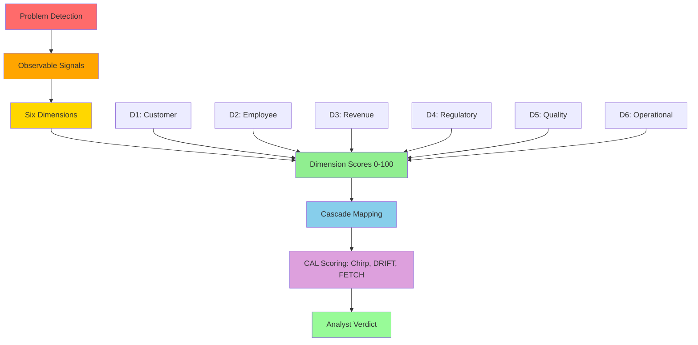

# Framework Overview

> **"What gets measured becomes manageable. What gets observed becomes measurable."**

The 6D Foraging Methodology™ is a framework for tracing how a problem spreads across **six dimensions** of an organization, using cited evidence at every step.

## The Problem

Most analysis stops at the dimension where a problem first shows up. A labor decision gets read as a labor story. A product defect gets read as a quality story.

The 6D view follows the problem further. It asks which other dimensions it reaches, in what order, and what evidence shows each step. The result is a cascade, written in a short notation:

```
D5 > D2+D6 > D4+D1
```

Read `>` as "then reaches" and `+` as "in the same layer". This one is the recorded cascade of [UC-342](https://uc-342.stratiqx.com): it starts in Quality, reaches Employee and Operational, then Regulatory and Customer.

Earlier versions of this page priced cascades with dollar multipliers ("direct cost × multiplier = total impact") and a fictional aviation maintenance example. Those were not drawn from any published case and have been removed.

## Framework Architecture



## The Six Dimensions

Each dimension represents a distinct impact area with:

- **Observable signals** — Concrete, measurable indicators
- **Data sources** — Where to find the signals
- **Trigger keywords** — Language patterns indicating severity
- **Metrics** — Leading and lagging indicators
- **Cascade pathways** — Where impact has spread to in the published cases

### D1: Customer Impact

**Core Question:** How does this problem affect the people who pay us?

**Key Observables:**
- Support ticket spike (Zendesk, ServiceNow)
- NPS/CSAT score drop (Survey platforms)
- Renewal hesitation (CRM notes)
- Churn requests (Billing system)

**Most common next layer in the library:** Revenue (29 of the 50 cases that start in Customer)

[→ Learn more about Customer Impact](../dimensions/customer.md)

### D2: Employee Impact

**Core Question:** How does this problem affect the people who work for us?

**Key Observables:**
- Overtime hours spike (HRIS, timesheets)
- Engagement score drop (Pulse surveys)
- Resignation notices (HR system)
- Meeting no-shows (Calendar analytics)

**Most common next layer in the library:** Revenue (31 of the 59 cases that start in Employee)

[→ Learn more about Employee Impact](../dimensions/employee.md)

### D3: Revenue Impact

**Core Question:** How does this problem affect money coming in?

**Key Observables:**
- Invoice disputes (AR aging)
- Discount requests (Sales CRM)
- Deal slippage (Forecast system)
- SLA breach payments (Contract management)

**Most common next layer in the library:** Operational (65 of the 96 cases that start in Revenue)

[→ Learn more about Revenue Impact](../dimensions/revenue.md)

### D4: Regulatory Impact

**Core Question:** How does this problem affect our compliance and legal standing?

**Key Observables:**
- Audit findings (Compliance reports)
- Documentation gaps (Process audits)
- Non-compliance notices (Legal/Compliance)
- Expired certifications (LMS/HR)

**Most common next layer in the library:** Revenue (36 of the 57 cases that start in Regulatory)

[→ Learn more about Regulatory Impact](../dimensions/regulatory.md)

### D5: Quality Impact

**Core Question:** How does this problem affect what we deliver?

**Key Observables:**
- Defect rate spike (QA system)
- Rework hours increase (Timesheets)
- Customer complaint volume (Support)
- Product returns (RMA system)

**Most common next layer in the library:** Operational (45 of the 81 cases that start in Quality)

[→ Learn more about Quality Impact](../dimensions/quality.md)

### D6: Operational Impact

**Core Question:** How does this problem affect how we work?

**Key Observables:**
- System downtime (Monitoring/APM)
- Queue length increase (Workflow systems)
- Processing time up (Metrics dashboards)
- Manual workarounds (Process documentation)

**Most common next layer in the library:** Revenue (55 of the 74 cases that start in Operational)

[→ Learn more about Operational Impact](../dimensions/operational.md)

## Dimension Scores and the 3D Lens

Each dimension a case reaches gets a score from 0 to 100, set from cited evidence. Not every case scores all six. [UC-335](https://uc-335.stratiqx.com) scores five and leaves Revenue out.

The 3D Lens is a way to think a dimension score through:

| Lens | What It Measures | Integration |
|------|------------------|-------------|
| **Sound (ChirpIQX)** | **Urgency** — How immediate is the signal? | Aggressive tone, trigger keywords, immediate hooks |
| **Space (PerchIQX)** | **Scope** — How widespread is the impact? | Positioning, strategic framing, affected population |
| **Time (WakeIQX)** | **Trajectory** — Is it improving or degrading? | Past patterns, memory, trend direction |

```
Dimension Score = (Sound × Space × Time) ÷ 10

Each factor is scored 1-10:
- Sound: 1 = future risk, 10 = active crisis
- Space: 1 = isolated incident, 10 = enterprise-wide
- Time: 1 = one-time occurrence, 10 = accelerating trend
```

[→ Learn more about the 3D Lens](../cormorant-integration/index.md)

## Cascade Pathways

Any dimension can reach any other. What the [published library](https://uc-000.stratiqx.com) can show is where cascades have actually gone. These are counts from the published library (331 cases with a recorded cascade, as of November 2026), not probabilities:

| Dimension | Origin of | Reached in (any layer) | Lands in the last layer |
|---|---|---|---|
| D1 Customer | 50 | 301 of 331 | 65 of 331 |
| D2 Employee | 59 | 295 of 331 | 132 of 331 |
| D3 Revenue | 96 | 304 of 331 | 18 of 331 |
| D4 Regulatory | 57 | 285 of 331 | 158 of 331 |
| D5 Quality | 81 | 294 of 331 | 49 of 331 |
| D6 Operational | 74 | 312 of 331 | 33 of 331 |

A case can have more than one origin dimension, so the origin column adds up to more than 331.

Two things stand out. Regulatory is the dimension that most often lands last: it tends to respond to what has already happened elsewhere. Revenue is the most common origin but rarely the last stop.

### Most Common Next Layer, by Origin

| Origin | Next layer includes (count of cases) |
|---|---|
| D1 Customer (50) | Revenue 29, Quality 26, Operational 23, Employee 5, Regulatory 2 |
| D2 Employee (59) | Revenue 31, Operational 27, Quality 18, Customer 13, Regulatory 7 |
| D3 Revenue (96) | Operational 65, Customer 43, Quality 32, Regulatory 20, Employee 16 |
| D4 Regulatory (57) | Revenue 36, Operational 29, Customer 25, Quality 14, Employee 11 |
| D5 Quality (81) | Operational 45, Revenue 39, Customer 29, Regulatory 13, Employee 12 |
| D6 Operational (74) | Revenue 55, Quality 35, Customer 33, Employee 11, Regulatory 11 |

A next layer often holds two dimensions, so a row can add up to more than its case count.

[→ Learn more about Cascade Pathways](cascade-pathways.md)

## Scoring a Case (CAL)

The scoring itself belongs to CAL ([spec v1.2.0](https://doi.org/10.5281/zenodo.24090152)):

```
Chirp      = average of the scored dimensions
DRIFT      = |Methodology − Performance|
Confidence = the analyst's 0-1 rating of evidence quality
FETCH      = Chirp × DRIFT × Confidence
```

FETCH is compared with a threshold T (default 1,000). The levels are EXECUTE at T or above, CONFIRM at 0.75T or above, QUEUE at 0.5T or above, and WAIT below that.

The case's written verdict is the analyst's separate reading and can differ from the level. [UC-335](https://uc-335.stratiqx.com) scores 2,646 and its verdict is MONITOR.

[→ Learn more about Scoring Methodology](scoring.md)

## Observable Properties

The framework works because it focuses on **concrete, measurable signals** rather than abstract categories:

### Before 6D Foraging
```
❌ "This might hurt customer satisfaction"
❌ "Employees seem stressed"
❌ "We could lose revenue"
```

### After 6D Foraging
```
✅ "Support tickets up ___% this week vs the 30-day baseline"
✅ "___ overtime hours reported, engagement score down from ___ to ___"
✅ "___ invoices disputed, AR over 60 days up from ___% to ___%"
```

Each dimension has:

- **Signal types** (Immediate, Behavioral, Sentiment, Silent)
- **Trigger keywords** (High/Medium/Low urgency language patterns)
- **Data sources** (Specific systems to check)
- **Metrics** (Leading and lagging indicators)

[→ Read the complete Observable Properties Framework](observable-properties.md)

## Using the Framework

### 1. Detect the Problem

Look for observable signals in your systems and sources, not gut feelings.

### 2. Score Each Dimension

Give each dimension the evidence reaches a 0-100 score. Cite the evidence. Leave out dimensions the evidence does not reach.

### 3. Map the Cascade

Write the order the problem spreads in, layer by layer: `origin > first layer > next layer`.

### 4. Score with CAL

Set Methodology and Performance, rate Confidence, and let CAL compute Chirp, DRIFT and FETCH.

### 5. Write the Verdict

Read the level, then write your own verdict. For a prognostic case, add triggers and a review date so it can be graded later.

## Real-World Application

[UC-246](https://uc-246.stratiqx.com), Starbucks, worked through end to end:

| Step | Result |
|------|--------|
| 1. Detect | A $500M+ labor investment in 8,000 "coffeehouse coaches" alongside an AI build |
| 2. Score | All six dimensions scored; Chirp 76.5 |
| 3. Map | `D3 > D1+D5 > D2 > D6 > D4` (in the case's own numbering, see below) |
| 4. Score with CAL | Methodology 85, Performance 45, DRIFT 40, Confidence 0.86, FETCH 2,632 |
| 5. Verdict | EXECUTE, High Priority |

UC-246 was published under an earlier numbering, used in cases UC-244 to UC-302, where D2 was Revenue and D3 was Employee. In the current numbering its cascade reads `D2 > D1+D5 > D3 > D6 > D4`.

[→ See more case studies](../applications/case-studies.md)

## Next Steps

<div class="next-steps">

**📖 [Observable Properties Framework](observable-properties.md)** — Complete signal catalog

**📊 [Scoring Methodology](scoring.md)** — Dimension scores, the 3D lens and CAL

**🔄 [Cascade Pathways](cascade-pathways.md)** — Trace where problems spread

**🎯 [Explore the Six Dimensions](../dimensions/customer.md)** — Deep dive into each impact area

</div>

<style>
.next-steps {
  background: #161b22;
  padding: 2rem;
  border-radius: 12px;
  margin: 3rem 0;
  border-left: 4px solid #1a237e;
}

.next-steps a {
  color: #58a6ff;
  text-decoration: none;
  font-weight: 600;
}

.next-steps a:hover {
  text-decoration: underline;
}
</style>

---

**The cascade is real. The evidence is cited. Now you can see it.** 🪶
