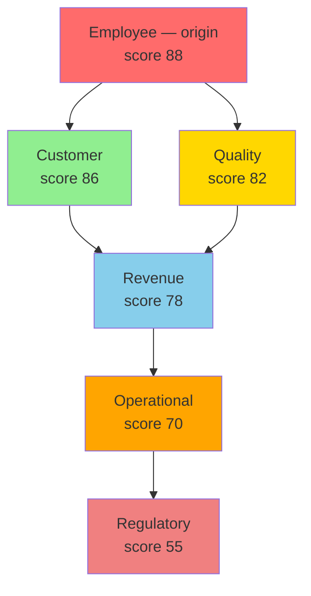

# Getting Started with 6D Foraging

> **"Dive deep across six dimensions to discover what others miss."**

## Quick Start

The 6D Foraging Methodology™ is strategic foraging across six business dimensions. Like cormorants diving beneath the surface, we systematically forage deep to find where a problem has spread beyond the dimension where it first showed up.

### The Core Question

When you encounter a problem, ask:

> **"Where else has this problem reached, and what evidence shows it?"**

### The Six Dimensions

| D | Dimension | Core Question |
|---|-----------|---------------|
| **1** | [Customer](dimensions/customer.md) | How does this affect who pays us? |
| **2** | [Employee](dimensions/employee.md) | How does this affect who works for us? |
| **3** | [Revenue](dimensions/revenue.md) | How does this affect money coming in? |
| **4** | [Regulatory](dimensions/regulatory.md) | How does this affect our compliance? |
| **5** | [Quality](dimensions/quality.md) | How does this affect what we deliver? |
| **6** | [Operational](dimensions/operational.md) | How does this affect how we work? |

## Your First 6D Analysis

### Step 1: Identify Observable Signals

Don't rely on intuition — look for **concrete signals** in your systems. Here's a real one, [UC-246](https://uc-246.stratiqx.com):

```
Example: Starbucks' "coffeehouse coach" bet
├── Employee (origin): 8,000 coaches hired/promoted, $500M+ labor investment
├── Customer: the "third place" experience, "improved customer experiences"
├── Quality: "more consistent performance" reported in the pilot
├── Revenue: N. America comps +7.1%, margins compressed by the investment
├── Operational: Deep Brew, Green Dot Assist AI running in parallel
└── Regulatory: labor relations backdrop, ~$1B restructuring alongside it
```

### Step 2: Apply the 3D Lens

For each affected dimension, score three factors (1-10):

| Lens | Question | Scale |
|------|----------|-------|
| **Sound (Urgency)** | How immediate is the problem? | 1 = future risk, 10 = active crisis |
| **Space (Scope)** | How widespread is the impact? | 1 = isolated, 10 = enterprise-wide |
| **Time (Trajectory)** | Is it getting worse or better? | 1 = one-time, 10 = accelerating |

**Dimension Score = (Sound × Space × Time) ÷ 10**

The result sits on the same 0-100 scale as a case's dimension scores. Whatever route you take to the number, it has to rest on cited evidence. Not every case scores all six dimensions; score only the ones the evidence reaches.

### Step 3: Map the Cascade

Problems **propagate** across dimensions — here's UC-246's real path, cited evidence at every hop, no probability guesses:



**Cascade notation:** `D3 > D1+D5 > D2 > D6 > D4`

Read `>` as "then reaches" and `+` as "in the same layer". UC-246 was published under an earlier numbering, used in cases UC-244 to UC-302, where D2 was Revenue and D3 was Employee. In the current numbering (the table above) the same cascade reads `D2 > D1+D5 > D3 > D6 > D4`.

### Step 4: Reach a Verdict

Real cases don't sum cascade dollars into a "total impact" — they compute **DRIFT** and **FETCH**:

| Term | Value | What it means |
|------|-------|----------------|
| METHODOLOGY | 85 | How sound is the reasoning (Niccol's own stated diagnosis) |
| PERFORMANCE | 45 | How proven is the outcome so far (comps recovering, margins compressed) |
| **DRIFT** | \|85 − 45\| = **40** | The gap between the two |
| CHIRP | 76.5 | The average of the six dimension scores above |
| CONFIDENCE | 0.86 | How well-sourced the whole analysis is (8 cited sources) |
| **FETCH** | 76.5 × 40 × 0.86 = **2,632** | Compared against THRESHOLD 1,000 |
| **Verdict** | **EXECUTE, High Priority** | 2,632 is above 2T (2,000), CAL's high-priority band |

Full mechanics: [Scoring Methodology](framework/scoring.md). Full narrative: [the case study](applications/case-studies.md).

## Key Concepts to Master

### 1. Observable Properties

Don't guess — measure. Each dimension has specific:

- **Signals** — What to look for (ticket spikes, overtime hours, NPS drops)
- **Data sources** — Where to find it (Zendesk, HRIS, CRM)
- **Trigger keywords** — Language patterns indicating severity
- **Metrics** — Leading and lagging indicators

📖 [Read more: Observable Properties Framework](framework/observable-properties.md)

### 2. Cascade Pathways

Problems don't stay isolated, but the specific path depends on the case. There is no fixed probability table. What the library can give you is counts. Across the published library (331 cases with a recorded cascade, as of November 2026, [index](https://uc-000.stratiqx.com)):

- Regulatory lands in the last layer in 158 of 331 cases, more than any other dimension.
- Revenue is the most common origin (96 cases) but lands last in only 18.
- Operational is reached in 312 of 331 cases, more than any other dimension.

Real, cited examples:

| Case | Origin | Real Cascade |
|------|--------|--------------|
| [UC-342](https://uc-342.stratiqx.com) | Quality | `D5 > D2+D6 > D4+D1` |
| [UC-335](https://uc-335.stratiqx.com) | Operational | `D6 > D2+D5 > D4+D1` |
| [UC-324](https://uc-324.stratiqx.com) | Revenue | `D3 > D6+D2 > D5+D1` |

📖 [Read more: Cascade Pathways](framework/cascade-pathways.md)

### 3. Reaching a Verdict: DRIFT and FETCH

Dimension scores tell you *how severe*. A second calculation, **FETCH**, tells you *what to do*:

- **DRIFT** = \|METHODOLOGY − PERFORMANCE\| — the gap between the diagnosis and the proof
- **CHIRP** — the overall severity signal across affected dimensions
- **CONFIDENCE** (0–1) — how well-sourced the analysis is
- **FETCH** = CHIRP × DRIFT × CONFIDENCE, compared against a **THRESHOLD** T (default 1,000). CAL's levels: EXECUTE at T or above (high priority at 2T or above), CONFIRM at 0.75T or above, QUEUE at 0.5T or above, WAIT below. Defined in the CAL spec v1.2.0 ([DOI 10.5281/zenodo.24090152](https://doi.org/10.5281/zenodo.24090152))
- **Verdict** — the analyst's reading of the cascade (EXECUTE, MONITOR, WATCH, COUNTER…), recorded alongside the score, not computed from it. [UC-335](https://uc-335.stratiqx.com) scores 2,646 and its verdict is MONITOR

📖 [Read more: Scoring Methodology](framework/scoring.md)

### 4. Cormorant Foraging Integration

The 3D lens comes from the **Cormorant Foraging Framework**:

- **ChirpIQX (Sound)** — Urgency analysis (immediate hooks, aggressive signals)
- **PerchIQX (Space)** — Scope analysis (positioning, strategic framing)
- **WakeIQX (Time)** — Trajectory analysis (past patterns, memory, trends)

📖 [Read more: Cormorant Integration](cormorant-integration/index.md)

## Learning Path

### For Self-Reference (Your Use Case)

1. **Start with one dimension** — Pick the one most relevant to your current work
2. **Memorize trigger keywords** — Print the [Quick Reference Card](reference/quick-card.md)
3. **Practice scoring** — Use the 3D lens on real problems
4. **Map cascades** — Draw them out until the patterns stick
5. **Use the glossary** — Reference definitions as you go

### For Teaching Others

1. **Start with the story** — Show a [real case](applications/case-studies.md), origin to verdict
2. **Explain one cascade** — Visual > abstract
3. **Give them the checklist** — Dimensions + 3D lens
4. **Let them score something** — Practice on a real problem
5. **Debrief the cascade** — Why did it spread this way, and what evidence shows it?

## Quick Reference

Print this for your desk:

| D | Dimension | Key Metric | High Urgency Signal |
|---|-----------|------------|---------------------|
| 1 | Customer | NPS, Churn | "Canceling", "Legal action" |
| 2 | Employee | Turnover, Engagement | "I'm done", "Burned out" |
| 3 | Revenue | AR Aging, Margin | "Penalty clause", "Termination" |
| 4 | Regulatory | Audit Findings, Fines | "Violation", "Investigation" |
| 5 | Quality | Defect Rate, Rework | "Recall", "Safety incident" |
| 6 | Operational | Uptime, Cycle Time | "System down", "Outage" |

**3D Lens Quick Check:**
- Sound: How urgent? (1=future, 10=crisis)
- Space: How widespread? (1=isolated, 10=enterprise-wide)
- Time: Getting better or worse? (1=one-time, 10=accelerating)

## Next Steps

<div class="next-steps">

**🎯 [Explore the Six Dimensions](dimensions/customer.md)** — Deep dive into each impact area

**📊 [Learn Cascade Analysis](applications/cascade-analysis.md)** — Trace a cascade step by step

**🔧 [See Real Case Studies](applications/case-studies.md)** — Learn from actual implementations

**📖 [Complete Framework Guide](framework/index.md)** — Read the full methodology

</div>

<style>
.next-steps {
  background: #161b22;
  padding: 2rem;
  border-radius: 12px;
  margin: 3rem 0;
  border-left: 4px solid #1a237e;
}

.next-steps a {
  color: #58a6ff;
  text-decoration: none;
  font-weight: 600;
}

.next-steps a:hover {
  text-decoration: underline;
}
</style>

---

**Ready to start measuring?** Begin with [D1: Customer Impact](dimensions/customer.md) or jump to the [Framework Overview](framework/index.md).
