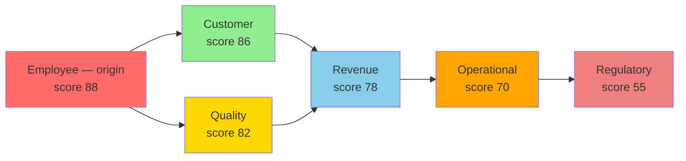

<style>
/* Home page styling - light mode only (dark mode in custom.css) */
:root {
  --vp-home-hero-name-color: transparent;
  --vp-home-hero-name-background: linear-gradient(120deg, #1a237e 30%, #0d47a1);
}

html:not(.dark) .VPHero {
  background: linear-gradient(180deg, #f0f2f5 0%, #ffffff 100%);
}

html:not(.dark) .VPHero .text {
  color: #2c3e50 !important;
}

html:not(.dark) .VPHero .tagline {
  color: #476582 !important;
}

html:not(.dark) .VPFeatures {
  background: #f6f6f7;
}

html:not(.dark) .VPFeature {
  background: #ffffff;
  border: 1px solid #e2e2e3;
  transition: all 0.3s ease;
}

html:not(.dark) .VPFeature:hover {
  border-color: #1a237e;
  box-shadow: 0 4px 12px rgba(26, 35, 126, 0.1);
  transform: translateY(-2px);
}
</style>

## What is 6D Foraging?

The **6D Foraging Methodology™** is strategic foraging across six business dimensions to see what a single-dimension view misses. Like cormorants diving beneath the surface, we forage deep — on the hypothesis that most analysis stops at the visible dimension and never checks the rest.

That's a hypothesis, not a settled statistic — and it's one we hold ourselves to. Every case in the [live library](https://uc-000.stratiqx.com) gets a scheduled review date; when the evidence doesn't support the original thesis, [we publish that too](https://uc-080.stratiqx.com) — not just the wins.

```
Origin Dimension:  Employee — score 88/100
         ↓
Cascade Reaches:   6 of 6 dimensions — D1, D5, D2, D6, D4
         ↓
Verdict:           FETCH 2,632 vs. THRESHOLD 1,000 → EXECUTE
```
*(Real numbers from [UC-246](https://uc-246.stratiqx.com), below. UC-246 was published under an earlier numbering, used in UC-244 to UC-302, where D3 was Employee and D2 was Revenue. This site uses D2 Employee and D3 Revenue.)*

### The Foraging Advantage

Strategic foraging delivers:

- **Deep discovery** — Dive across 6 dimensions, not just the visible one
- **Observable signals** — Track concrete, cited metrics, not assumptions
- **Cascade mapping** — See how a dimension's evidence actually propagates
- **A real verdict** — DRIFT and FETCH against a stated threshold, not a vibe

### The 3D Lens (Cormorant Foraging)

Each dimension is analyzed through three lenses:

| Lens | What It Measures | Range |
|------|------------------|-------|
| **Sound (ChirpIQX)** | Urgency — How immediate is the signal? | 1-10 |
| **Space (PerchIQX)** | Scope — How widespread is the impact? | 1-10 |
| **Time (WakeIQX)** | Trajectory — Is it improving or degrading? | 1-10 |

**Dimension Score = (Sound × Space × Time) ÷ 10**

## Why It Matters



**No dollar figure is summed across these dimensions** — that's a real double-counting risk, not a style choice (the same dollars can get counted once as "lost revenue" and again as "damaged customer relationship"). Each dimension is scored on its own cited evidence; the verdict comes from FETCH, not an addition problem.

### What the Library Shows

Across the published library (331 cases with a recorded cascade, as of November 2026, [index](https://uc-000.stratiqx.com)), every recorded cascade reaches past its origin. Regulatory lands in the last layer in 158 of the 331, more often than any other dimension. These are counts of what was recorded, not probabilities.

## Real-World Example

**[UC-246](https://uc-246.stratiqx.com) — Starbucks' "Coffeehouse Coach" Bet:**

| Dimension | Observable Signal | Score |
|-----------|-------------------|-------|
| **Employee** (Origin) | 8,000 "coffeehouse coaches," $500M+ labor investment | 88 |
| **Customer** | The "third place" experience, "improved customer experiences" | 86 |
| **Quality** | "More consistent performance" reported in the pilot | 82 |
| **Revenue** | N. America comps +7.1%, margins compressed by the investment | 78 |
| **Operational** | Deep Brew, Green Dot Assist AI running in parallel | 70 |
| **Regulatory** | Labor relations backdrop, ~$1B restructuring alongside it | 55 |

**FETCH 2,632 vs. THRESHOLD 1,000 → EXECUTE, High Priority.** Eight primary sources, [fully cited](https://uc-246.stratiqx.com).

## Get Started

<div class="next-steps">

**📚 [Getting Started Guide](getting-started.md)** — Learn how to apply the framework

**🎯 [Six Dimensions](dimensions/customer.md)** — Deep dive into each impact area

**📊 [Cascade Analysis](applications/cascade-analysis.md)** — Map how a problem actually propagates

**🔍 [Quick Reference Card](reference/quick-card.md)** — Cheat sheet for rapid assessment

</div>

<style>
.next-steps {
  background: #161b22;
  padding: 2rem;
  border-radius: 12px;
  margin: 3rem 0;
  border-left: 4px solid #1a237e;
}

.next-steps a {
  color: #58a6ff;
  text-decoration: none;
  font-weight: 600;
}

.next-steps a:hover {
  text-decoration: underline;
}
</style>

---

<div style="text-align: center; padding: 3rem 0; color: #8b949e; font-style: italic;">
  "Most analysis stops at the visible cost. They miss the cascade. Now you can see it."
</div>
